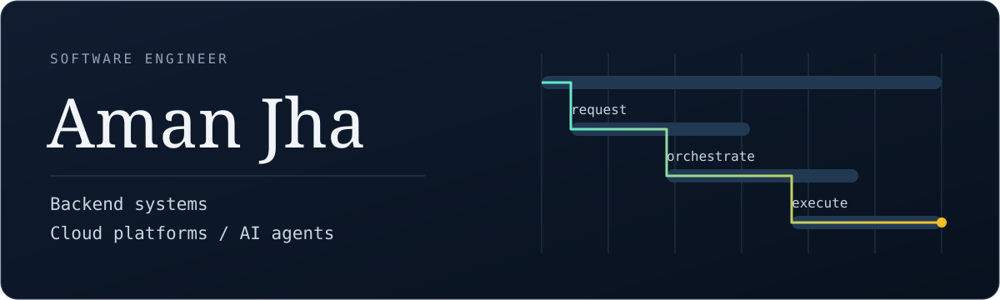

  

## Aman Jha

I'm a software engineer at Microsoft building backend systems and platforms for AI agents. My work spans distributed services, durable workflows, and the infrastructure that keeps them running.

I also build smaller things outside work, from document-based assistants to games that run over a local network.

### Selected work

**[Office Scribble](https://github.com/inofficialamanjha/OFFICE_SCRIBBLE)** 
A drawing-and-guessing game for a local network. One laptop hosts; players join on their phones. Built with Node.js, Express, and Socket.IO.

**[Page-RAG](https://github.com/inofficialamanjha/Page-RAG)** 
A personal Python FAQ assistant with document ingestion and persistent recall, using Azure OpenAI with optional Flask hosting.

### Toolbox

C# / .NET, Python, Azure, Kubernetes, event-driven services, and agent orchestration.

[Historical portfolio archive](Portfolio/) &nbsp;&middot;&nbsp; [LinkedIn](https://www.linkedin.com/in/amanjhaofficial/)

This space is for personal projects. Employer code and internal material stay private.
